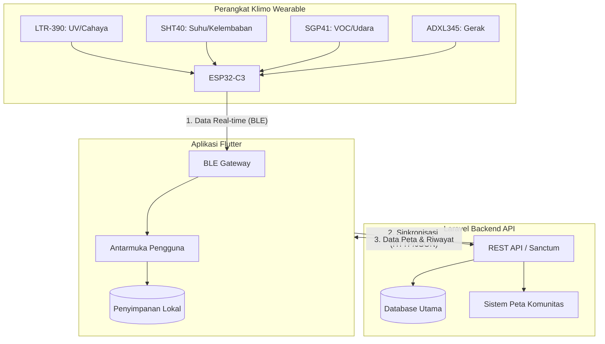
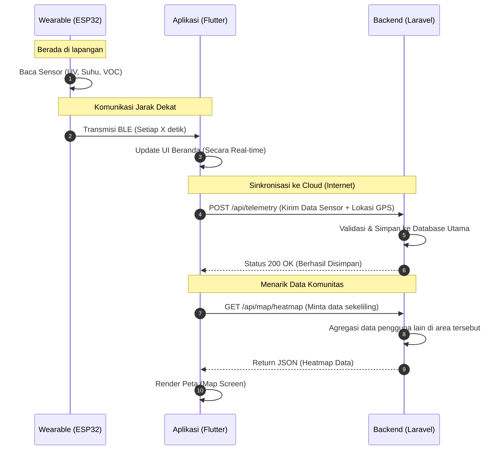

# Analisis Flow dan Arsitektur Aplikasi Klimo

Berdasarkan proposal dan kode yang telah kita buat, **ya, aplikasi kita sudah sangat sesuai dengan proposal awal.** 

Berikut adalah kesesuaian fitur aplikasi kita dengan proposal:
1. **Sensor Integrasi:** UI kita sudah disiapkan untuk menampilkan parameter dari *hardware* secara *real-time*:
   - Indeks UV (Sensor LTR-390)
   - Suhu & Kelembaban (Sensor SHT40) yang mengindikasi potensi *Heat Stress*
   - Kualitas Udara / VOC (Sensor SGP41)
2. **Kebutuhan Pengguna (Target User):** Aplikasi sudah didesain mudah dibaca dengan warna-warna yang sangat jelas (terutama di Dark Mode) yang sangat cocok untuk *outdoor workers*. Ada halaman Detail UV khusus yang menampilkan visual aman/bahaya secara melingkar (gauge).
3. **Peta Komunitas:** Fitur *Map Screen* sudah disiapkan pada navigasi utama untuk memetakan kondisi sekitar berdasarkan komunitas (Community Mapping).
4. **Alat / BLE:** Menu "Alat" sudah ada sebagai tempat untuk koneksi Bluetooth Low Energy (BLE) ke perangkat *wearable*.

Berikut adalah diagram alur (Flowchart) dari keseluruhan sistem. Anda dapat melihatnya langsung pada *viewer* Markdown yang mendukung Mermaid.js.

---

## 1. Arsitektur Sistem Keseluruhan (System Architecture)

Diagram ini menunjukkan bagaimana perangkat keras (*hardware*), aplikasi mobile (*mobile app*), dan backend berinteraksi satu sama lain.



---

## 2. Alur Navigasi Aplikasi (App Navigation Flow)

Diagram ini menunjukkan bagaimana pengguna menavigasi dari mulai membuka aplikasi, masuk/login, hingga menjelajahi 5 fitur utama di `BottomNavigationBar`.

```mermaid
graph TD
    Start([Buka Aplikasi]) --> Splash[Splash Screen]
    Splash --> CekLogin{Apakah Sudah\nLogin?}
    
    CekLogin -- Belum --> Login[Login Screen]
    Login -- Auth Sukses --> Main[Main Navigation]
    
    CekLogin -- Sudah --> Main
    
    subgraph Main Navigation [Bottom Navigation Bar]
        Beranda[1. Beranda\n(Dashboard Real-time)]
        Peta[2. Peta\n(Peta Komunitas)]
        Riwayat[3. Riwayat\n(Grafik Data Historis)]
        Alat[4. Alat\n(Manajemen Perangkat)]
        Profil[5. Profil\n(Pengaturan Akun)]
    end
    
    Main --> Beranda
    Main --> Peta
    Main --> Riwayat
    Main --> Alat
    Main --> Profil
    
    Beranda --"Klik Kartu UV"--> DetilUV[UV Detail Screen\n(Indikator Gauge & Tips)]
```

---

## 3. Alur Komunikasi Data (Data Flow Sequence)

Diagram urutan (*Sequence Diagram*) ini menjelaskan tahapan teknis bagaimana data berpindah dari titik sensor membaca kondisi lingkungan, dikirim ke HP, hingga ke Server (Backend).


