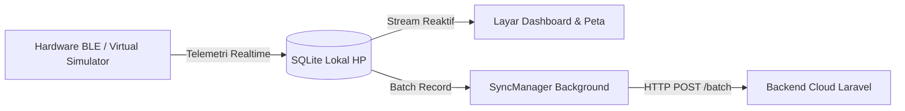

# 📱 Klimo Wearth - Flutter Mobile Application

Aplikasi mobile resmi untuk ekosistem **Klimo Wearth** (*Personal Weather & Wearable Microclimate Monitoring*), dibangun menggunakan **Flutter** dengan pendekatan arsitektur **Offline-First**.

---

## 🏛️ Arsitektur Aplikasi: Offline-First

Pekerja luar ruangan (*outdoor workers*) sering kali berada di area dengan konektivitas seluler yang lemah atau terputus. Oleh karena itu, KlimoApp mengadopsi model **Offline-First** (mirip arsitektur aplikasi *Huawei Health* atau *Garmin Connect*):



1. **Penyimpanan Lokal Instan**: Setiap data sensor dari Bluetooth Low Energy (BLE) langsung disimpan ke basis data SQLite lokal di perangkat melalui [`LocalDataService`](lib/services/local_data_service.dart).
2. **UI Cepat Tanpa Loading Network**: Dashboard dan visualisasi membaca data dari memori internal HP, sehingga UI sangat responsif tanpa bergantung pada kecepatan sinyal internet.
3. **Sinkronisasi Otomatis Berkala**: [`SyncManager`](lib/services/sync_manager.dart) berjalan di latar belakang setiap 30 detik. Saat perangkat mendeteksi koneksi internet (WiFi / Seluler), kumpulan data lokal diunggah secara batch ke Cloud API (`/api/telemetry/batch`).

---

## 🌟 Fitur & Halaman Aplikasi

### 1. Beranda (Home Dashboard)
* **Gauge UV Melingkar**: Menampilkan indeks paparan UV real-time dengan kode warna risiko (Aman, Waspada, Bahaya).
* **Kartu Metrik Lingkungan**: Indikator Suhu Udara (°C), Kelembaban (RH%), dan Kualitas Udara (Gas VOC).
* **Saran Proteksi Kulit**: Rekomendasi sunscreen (SPF 30 / SPF 50+) dan waktu aman di bawah sinar matahari yang dipersonalisasi sesuai tipe kulit pengguna.

### 2. Peta Lingkungan Spasial (Map Screen)
* **Peta Berorientasi Privasi (*Privacy-Preserving Area Heatmap*)**: Menggunakan *Spatial Grid Aggregation (~150 meter)* untuk mengelompokkan data sensor wilayah sekitar secara anonim tanpa menampilkan koordinat GPS presisi orang lain.
* **Pin Posisi Terpadu**: Pin pengguna dan nilai sensor digabungkan menjadi satu kapsul rapi (`📍 Posisi Kamu · ☀️ 2.9`) tanpa saling bertumpuk.
* **Filter Tab Dinamis**: Pilihan visualisasi antara **Sinar UV**, **Suhu Panas**, dan **Kualitas Udara**.

### 3. Manajemen Perangkat (Device Screen)
* **Status Koneksi Realtime**: Menampilkan status Bluetooth (*Terhubung / Terputus*).
* **Level Baterai & Hemat Daya**: Indikator daya baterai perangkat wearable dan pengaturan interval transmisi.
* **Fitur Hardware**: Tes getaran haptic (*vibration test*) dan spesifikasi teknis ESP32-C3.

### 4. Profil & Personalisasi (Profile Screen)
* **Tipe Kulit Fitzpatrick (Tipe I – VI)**: Klasifikasi warna kulit pengguna untuk perhitungan batas paparan UV dan anjuran SPF. Tersimpan di lokal dan otomatis sinkron ke akun server.
* **Mode Demo & 4 Skenario Cuaca**:
  1. *Otomatis (Fluktuatif dinamis)*
  2. *Normal / Sejuk*
  3. *Panas Ekstrem*
  4. *Polusi Udara*
* **Tema Tampilan**: Mendukung tema **Terang (Light)**, **Gelap (Dark)**, dan **Sistem (Auto)**.

### 5. Riwayat & Analisis (History Screen)
* Grafik tren mingguan paparan UV, suhu, dan polusi gas VOC.
* Log histori detail pencatatan lingkungan.

---

## 📁 Struktur Direktori `FlutterApps/`

```text
FlutterApps/
├── lib/
│   ├── main.dart                      # Entry point & routing aplikasi
│   ├── screens/                       # Halaman-halaman UI
│   │   ├── home_screen.dart           # Dashboard utama
│   │   ├── map_screen.dart            # Peta iklim kawasan anonim
│   │   ├── device_screen.dart         # Kontrol perangkat wearable
│   │   ├── profile_screen.dart        # Profil, tema, dan mode demo
│   │   ├── history_screen.dart        # Riwayat telemetri
│   │   ├── history_detail_screen.dart # Detail log pencatatan
│   │   ├── login_screen.dart          # Login email, Google OAuth, & Demo
│   │   └── setup/                     # Onboarding (Pairing & Tipe Kulit)
│   ├── services/                      # Logika bisnis & integrasi
│   │   ├── api_service.dart           # Komunikasi HTTP REST API
│   │   ├── local_data_service.dart    # SQLite engine lokal HP
│   │   ├── sync_manager.dart          # Background auto-sync batch
│   │   └── ble_simulator_service.dart # Virtual BLE sensor engine
│   └── theme/
│       └── app_theme.dart             # Styling tema terang & gelap
└── pubspec.yaml                       # Dependensi proyek
```

---

## 🚀 Cara Menjalankan

### 1. Unduh Dependensi
```bash
cd FlutterApps
flutter pub get
```

### 2. Jalankan di Emulator / Perangkat Fisik
```bash
# Mode Desktop (Linux / macOS / Windows)
flutter run -d linux

# Mode Android Smartphone
flutter run -d android
```

### 3. Kompilasi APK Production (Release)
```bash
flutter build apk --release
```
Hasil berkas biner APK akan berada di `build/app/outputs/flutter-apk/app-release.apk` atau dapat langsung diunduh dari folder [`release/`](../release/).

---

## 🧪 Pengujian Kode (Testing & Linter)
```bash
# Analisis kode (linter)
flutter analyze

# Jalankan unit & widget test
flutter test
```
