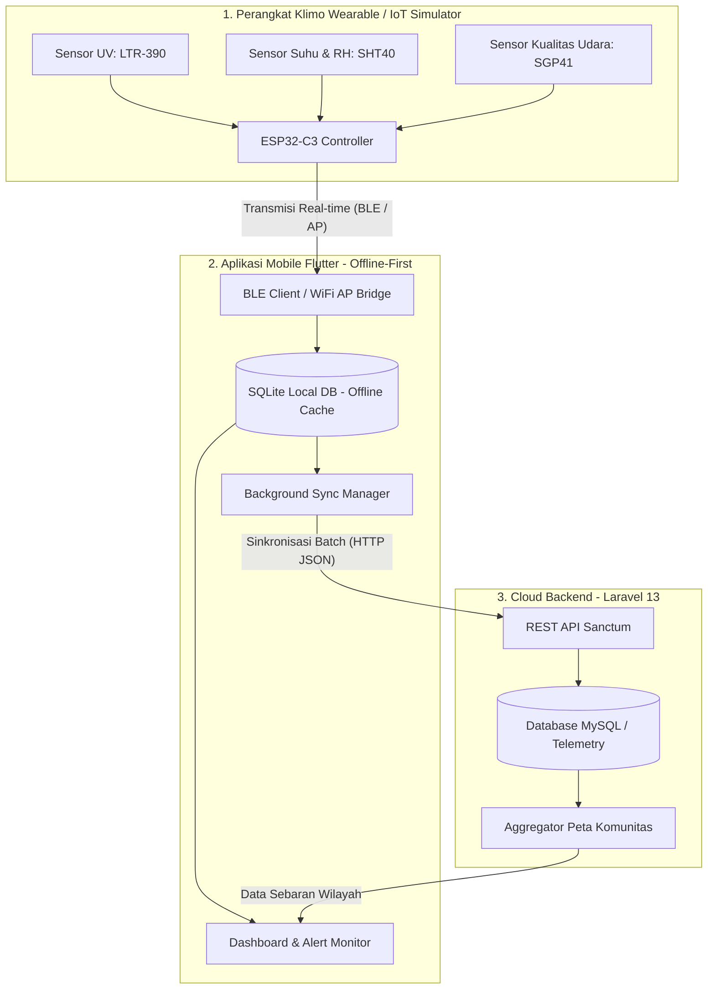
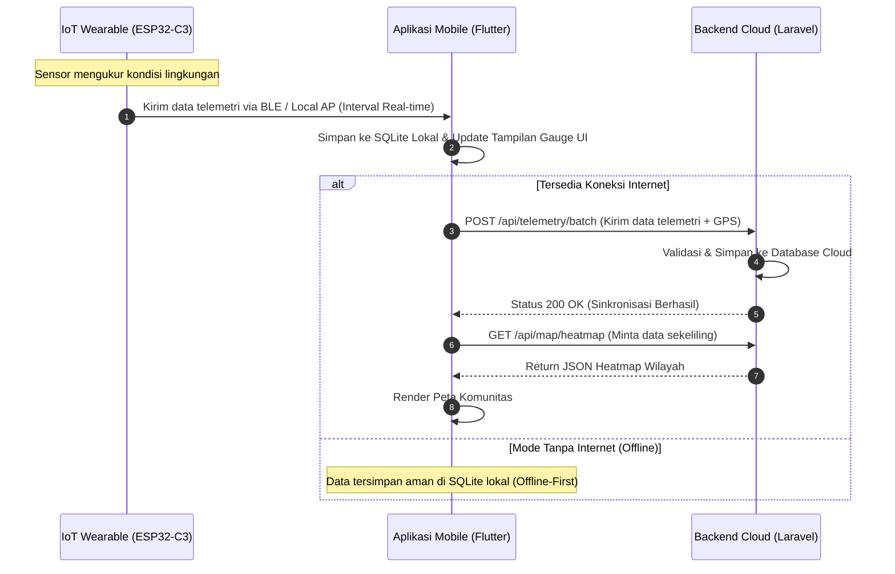

# KlimoApp (Klimo Wearth) 🌦️

Repository monorepo untuk proyek **Klimo Wearth** (Personal Weather & Wearable Microclimate Monitoring).

Repository ini terdiri dari 3 direktori utama:
1. `Backend/` — REST API Backend berbasis **Laravel 13** & Laravel Sanctum.
2. `IoT_Simulator/` — Simulator Sensor Python & Firmware **ESP32-C3** (PlatformIO).
3. `FlutterApps/` — Aplikasi mobile & desktop Flutter (UI Monitoring & Dashboard).

---

## 💡 Tentang Solusi: Klimo Wearth

**Klimo Wearth** (*Personal Weather & Wearable Microclimate Monitoring*) adalah solusi pemantauan iklim mikro dan perlindungan pekerja luar ruangan (*outdoor workers*) secara *real-time*. 

Solusi ini mengintegrasikan perangkat *wearable* IoT dengan aplikasi *mobile* berarsitektur *offline-first* dan *backend cloud* untuk memantau:
* **Indeks Paparan Radiasi UV** (dengan indikator visual tingkat risiko & saran proteksi).
* **Suhu & Kelembaban** (deteksi dini risiko *Heat Stress* / kelelahan panas).
* **Kualitas Udara & Indeks Gas VOC** (pemantauan polusi udara mikro).
* **Peta Sebaran Komunitas (*Community Heatmap*)** untuk memetakan kondisi iklim mikro sekitar berdasarkan data gabungan pengguna.

---

## 🔄 Alur Solusi & Arsitektur Sistem

Sistem Klimo Wearth bekerja dengan alur terintegrasi 3 lapisan (*Hardware Wearable*, *Aplikasi Mobile*, dan *Cloud Backend*):

### 1. Arsitektur Sistem (System Architecture)


### 2. Alur Pengiriman & Sinkronisasi Data (Data Flow Sequence)


---

## 📁 Struktur Direktori

```text
KlimoApp/
├── Backend/          # Laravel 13 API Backend
│   ├── app/
│   ├── database/     # Migrations & Seeders
│   ├── routes/api.php
│   └── ...
├── IoT_Simulator/    # Firmware ESP32-C3 & Software Simulator
│   ├── platformio.ini# Konfigurasi PlatformIO
│   ├── simulator.py  # Python sensor simulator (no hardware needed)
│   └── src/main.cpp  # Firmware C++ ESP32-C3
├── FlutterApps/      # Flutter Mobile App
│   ├── lib/          # UI, State & API Services
│   ├── pubspec.yaml
│   └── ...
├── run_demo.sh       # Script otomatis interaktif untuk menjalankan ekosistem
├── PANDUAN_MENJALANKAN.md # Panduan lengkap menjalankan seluruh komponen
└── README.md
```

---

## ⚡ Cara Menjalankan Cepat (All-in-One)

Gunakan skrip runner interaktif yang telah disediakan:

```bash
./run_demo.sh
```
Pilih opsi **`[4]`** untuk menyalakan Backend + IoT Simulator secara otomatis di background dan membuka aplikasi Flutter.

---

## 🚀 Panduan Menjalankan Manual (3 Terminal Terpisah)

Untuk melihat log setiap komponen secara jelas, buka 3 jendela terminal:

### 1. Backend (Laravel 13)
```bash
cd Backend
cp .env.example .env    # Jika belum ada
php artisan migrate --seed
php artisan serve --host=0.0.0.0 --port=8000
```
> **Akun Default untuk Uji Coba:**
> - **Email:** `test@example.com`
> - **Password:** `password`

### 2. IoT Simulator (Python / ESP32-C3)
```bash
cd IoT_Simulator
# Opsi A: Software Simulator (Python)
python3 simulator.py

# Opsi B: Hardware ESP32-C3 (PlatformIO)
pio run -t upload && pio device monitor -b 115200
```

### 3. Flutter App (`FlutterApps`)
```bash
cd FlutterApps
flutter pub get
flutter run
```

> 📖 Untuk panduan mendalam dan konfigurasi IP Emulator/Device fisik, baca [PANDUAN_MENJALANKAN.md](PANDUAN_MENJALANKAN.md).

---

## 🔑 Endpoint API Utama

| Method | Endpoint | Keterangan |
| :--- | :--- | :--- |
| `POST` | `/api/register` | Mendaftarkan akun baru |
| `POST` | `/api/login` | Login dan memperoleh Bearer Token Sanctum |
| `GET`  | `/api/profile` | Mengambil data user yang sedang login |
| `POST` | `/api/telemetry` | Mengirim data pembacaan sensor IoT (UV, Suhu, dsb.) |
| `GET`  | `/api/telemetry/history` | Riwayat data telemetri sensor |
| `POST` | `/api/logout` | Revoke token / logout |
