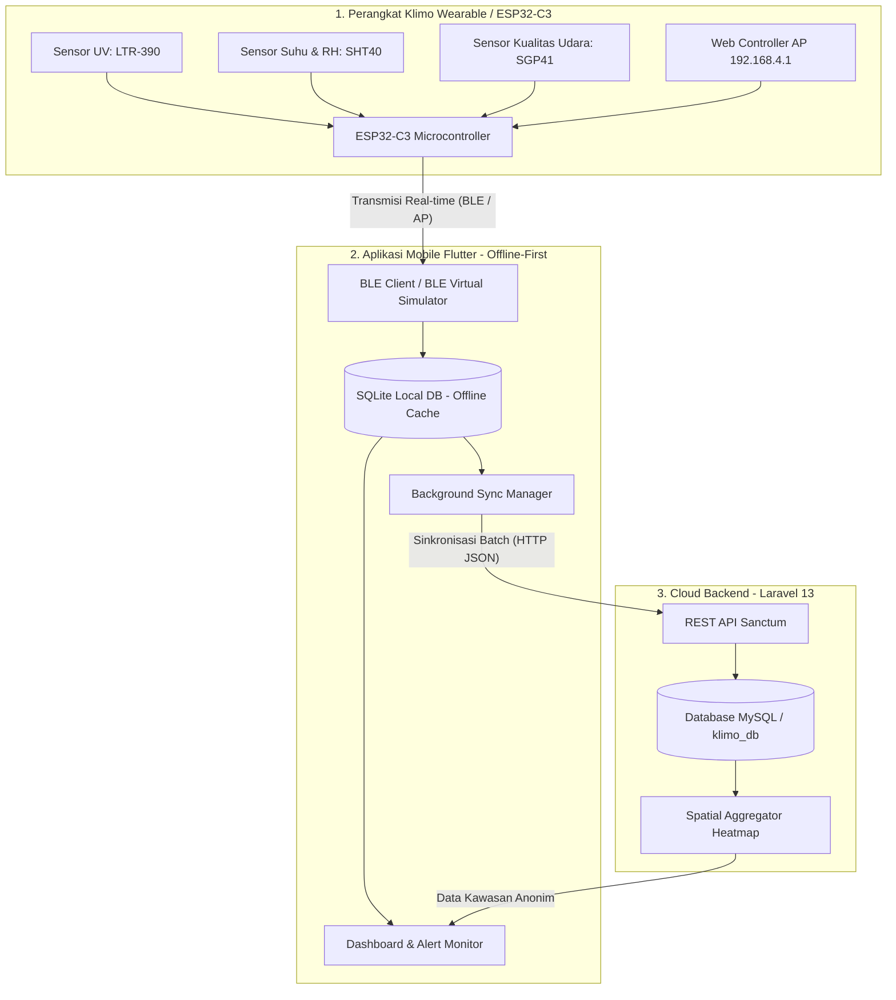
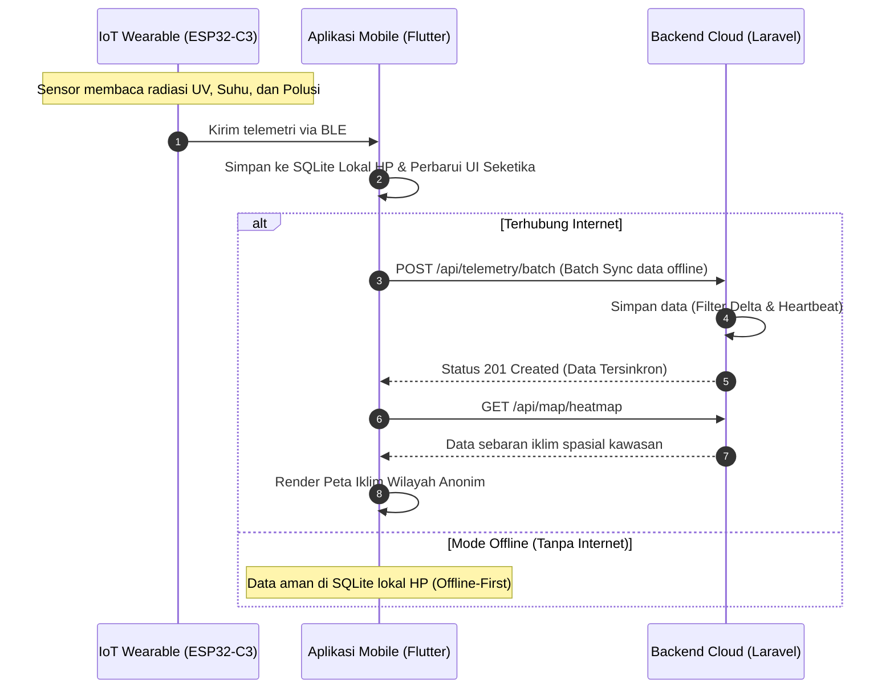

# KlimoApp (Klimo Wearth) 🌦️

[](https://flutter.dev)
[](https://apple.com)
[](https://laravel.com)
[](https://www.espressif.com)
[](https://platformio.org)
[](https://flutter.dev)

Monorepo resmi untuk proyek **Klimo Wearth** (*Personal Weather & Wearable Microclimate Monitoring*), sebuah ekosistem pemantauan iklim mikro pribadi dan perlindungan kesehatan kulit pekerja luar ruangan (*outdoor workers*) secara *real-time*.

---

## 📲 Unduh Aplikasi & CI/CD Pipeline

Untuk mencoba aplikasi di smartphone secara langsung:

* 🤖 **Android APK (Siap Pasang)**: [`release/KlimoApp-release.apk`](release/KlimoApp-release.apk) (~60.7 MB, Universal APK, Android 6.0+)
* 🍏 **iOS Build (CI/CD GitHub Actions)**: Pipeline otomatis di [`.github/workflows/build-ios.yml`](.github/workflows/build-ios.yml) (menghasilkan `KlimoApp-ios-release.ipa` menggunakan runner macOS M1).
* 📖 **Panduan Pasang**: [Baca Panduan Instalasi di release/README.md](release/README.md)

---

## 📚 Dokumentasi Khusus per Modul

Repositori ini tersusun secara modular. Untuk mempelajari detail arsitektur, kode, dan panduan teknis masing-masing komponen, silakan pilih dokumentasi di bawah ini:

| Modul | Dokumentasi Teknis | Deskripsi Singkat |
| :--- | :--- | :--- |
| 📱 **Mobile App** | [**`FlutterApps/README.md`**](FlutterApps/README.md) | Arsitektur Offline-First, SQLite Lokal, Screen UI, & Panduan Flutter |
| ☁️ **Backend API** | [**`Backend/README.md`**](Backend/README.md) | REST API Laravel 13, Sanctum Auth, Skema DB, & Delta Threshold Engine |
| 🛰️ **IoT & Hardware** | [**`IoT_Simulator/README.md`**](IoT_Simulator/README.md) | Firmware ESP32-C3, Wiring I2C Bus, Wokwi Circuit, & PlatformIO CLI |
| 📦 **Paket Rilis** | [**`release/README.md`**](release/README.md) | Paket APK Android Production Siap Pakai & Panduan Instalasi HP |

---

## 💡 Tentang Solusi: Klimo Wearth

Pekerja lapangan, kurir, atlet, dan masyarakat urban sering kali terpapar bahaya radiasi sinar UV ekstrem, suhu panas menyengat (*heat exhaustion*), serta akumulasi polusi gas beracun tanpa alat ukur objektif di tubuh mereka. 

**Klimo Wearth** menjawab tantangan ini dengan menggabungkan:
1. **Perangkat Wearable IoT (ESP32-C3)** yang mengukur kondisi mikro langsung di atmosfer sekitar tubuh.
2. **Aplikasi Mobile (Flutter)** berarsitektur *Offline-First* (mirip arsitektur *Huawei Health* / *Garmin Connect*) dengan penyimpanan lokal SQLite berkecepatan tinggi dan sinkronisasi cerdas ke cloud.
3. **Backend Cloud (Laravel 13 REST API)** dengan validasi data, *Sanctum authentication*, serta *Delta Threshold Filtering* untuk efisiensi basis data.

---

## ✨ Fitur-Fitur Utama

* **☀️ Pemantauan Sinar UV Real-Time**: Deteksi indeks UV dengan indikator risiko dinamis (Aman, Waspada, Bahaya) dan panduan proteksi kulit.
* **🧴 Personalisasi Tipe Kulit (Tipe I – VI)**: Menyesuaikan batas aman paparan sinar matahari dan rekomendasi sunscreen berdasarkan klasifikasi kulit *Fitzpatrick Scale*.
* **🌡️ Deteksi Suhu Panas & Heat Stress**: Memantau suhu lingkungan dan memperingatkan pengguna saat kondisi mendekati batas bahaya dehidrasi.
* **💨 Pemantauan Kualitas Udara (Gas VOC)**: Mengukur konsentrasi senyawa organik volatil di sekitar tubuh pengguna.
* **🗺️ Peta Iklim Kawasan Berorientasi Privasi (*Privacy-Preserving Area Heatmap*)**:
  * Menggunakan **Spatial Grid Aggregation (~150 meter)** untuk menampilkan rata-rata kondisi lingkungan wilayah makro.
  * **Privasi Terjamin**: Tidak melacak atau menampilkan titik GPS presisi pengguna lain, melainkan menghadirkan ringkasan iklim kawasan sekitar secara anonim.
  * Pin posisi terpadu yang rapi (`📍 Posisi Kamu · ☀️ UV 2.9`) dengan lingkaran halo proporsional.
* **💾 Arsitektur Offline-First (SQLite Internal)**: Data telemetri selalu tersimpan di memori HP terlebih dahulu sehingga aplikasi tetap berfungsi penuh meski tanpa sinyal internet.
* **⚡ Delta Threshold & Heartbeat Engine**: Backend hanya menyimpan baris telemetri baru jika terjadi perubahan nilai signifikan (UV ≥ 0.2, Suhu ≥ 0.3°C, VOC ≥ 10) atau sebagai checkpoint setiap 5 menit.
* **🧪 Mode Demo Interaktif & 4 Skenario Cuaca**:
  * Memungkinkan demonstrasi penuh tanpa perangkat fisik Bluetooth.
  * Pilihan skenario: **Otomatis (Fluktuatif)**, **Normal/Sejuk**, **Panas Ekstrem**, dan **Polusi Udara**.
* **📶 ESP32-C3 Web Controller (Demo Tanpa Sensor Kabel)**: Board ESP32 memancarkan WiFi AP internal (`Klimo-Simulator`) dengan Web Controller di browser (`http://192.168.4.1`) untuk simulasi live data.

---

## 🔄 Alur Solusi & Arsitektur Sistem

### 1. Arsitektur Sistem (System Architecture)


### 2. Alur Pengiriman & Sinkronisasi Data (Data Flow Sequence)


---

## 📁 Struktur Direktori

```text
KlimoApp/
├── release/                 # Berkas Paket Instalasi APK Android Siap Pakai
│   ├── KlimoApp-release.apk # Production APK (~60.7 MB)
│   └── README.md            # Panduan instalasi cepat ke HP Android
├── Backend/                 # Laravel 13 API Backend
│   ├── app/
│   │   ├── Http/Controllers/Api/  # AuthController & TelemetryController
│   │   └── Models/                # User, Device, Telemetry
│   ├── database/migrations/       # Skema tabel users, devices, telemetries
│   ├── routes/api.php             # Endpoint REST API
│   └── tests/Feature/             # Feature test suite (18 test passed)
├── IoT_Simulator/           # Firmware ESP32-C3 & Software Simulator
│   ├── platformio.ini       # Konfigurasi PlatformIO
│   ├── simulator.py         # Python sensor simulator (Backend injector)
│   ├── diagram.json         # Diagram simulasi sirkuit Wokwi
│   └── src/main.cpp         # Firmware C++ ESP32-C3 (BLE + Web AP Server)
├── FlutterApps/             # Aplikasi Mobile Flutter
│   ├── lib/
│   │   ├── screens/         # Home, Map, Device, Profile, History, Setup
│   │   ├── services/        # ApiService, LocalDataService (SQLite), BleSimulator
│   │   └── theme/           # Palet warna terang & gelap
│   └── pubspec.yaml
├── run_demo.sh              # Runner interaktif untuk Linux / macOS
├── run_demo.bat             # Runner interaktif untuk Windows
├── PANDUAN_MENJALANKAN.md    # Panduan setup komprehensif
└── README.md
```

---

## ⚡ Cara Menjalankan Cepat (Interactive Runner)

Kami telah menyediakan skrip *runner* interaktif yang siap pakai untuk **Linux** maupun **Windows**:

### Di Linux / macOS:
```bash
./run_demo.sh
```

### Di Windows (Command Prompt / PowerShell):
```cmd
run_demo.bat
```

> **Menu Interaktif:**
> * `[1]` Jalankan Aplikasi Flutter Saja
> * `[2]` Jalankan Backend Laravel Saja (`host: 0.0.0.0:8000`)
> * `[3]` Full Stack Demo (Backend Laravel di background + Flutter App)
> * `[4]` Flash Firmware ke Board ESP32 (PlatformIO Upload via USB)
> * `[5]` Buka Serial Monitor ESP32 (115200 baud)
> * `[6]` Kompilasi / Validasi Firmware ESP32
> * `[7]` Jalankan Python Simulator (Backend Data Injector)
> * `[8]` Info Panduan Demo Lomba & Web Controller ESP32

---

## 🚀 Panduan Menjalankan Manual (Per Komponen)

### 1. Backend (Laravel 13)
```bash
cd Backend
composer install
cp .env.example .env
php artisan key:generate
php artisan migrate --seed
php artisan serve --host=0.0.0.0 --port=8000
```
> **Kredensial Default Uji Coba:**
> - Email: `test@example.com`
> - Kata Sandi: `password`

### 2. IoT Simulator / Firmware ESP32
```bash
cd IoT_Simulator

# Opsi A: Software Python Simulator (Inject data langsung ke API)
python3 simulator.py

# Opsi B: Hardware ESP32-C3 (Upload firmware via USB)
pio run -t upload && pio device monitor -b 115200
```

### 3. Aplikasi Flutter
```bash
cd FlutterApps
flutter pub get
flutter run
```

---

## 🔑 Endpoint REST API

| Method | Endpoint | Keterangan | Autentikasi |
| :--- | :--- | :--- | :---: |
| `POST` | `/api/register` | Mendaftarkan akun baru (nama, email, password, skin_type) | Publik |
| `POST` | `/api/login` | Masuk dan memperoleh Sanctum Bearer Token | Publik |
| `POST` | `/api/login/google` | Autentikasi akun Google terintegrasi backend | Publik |
| `POST` | `/api/logout` | Revoke token autentikasi sesi aktif | Bearer Token |
| `GET`  | `/api/profile` | Mengambil data profil pengguna & tipe kulit | Bearer Token |
| `PUT`  | `/api/profile` | Memperbarui nama dan/atau tipe kulit | Bearer Token |
| `GET`  | `/api/devices` | Mengambil daftar perangkat pengguna | Publik / Token |
| `POST` | `/api/devices` | Mendaftarkan & menautkan perangkat ke akun pengguna | Publik / Token |
| `POST` | `/api/telemetry` | Mengirim data sensor (Delta Threshold & Heartbeat filter) | Publik / Token |
| `POST` | `/api/telemetry/batch` | Sinkronisasi kumpulan data offline sekaligus dari HP | Publik / Token |
| `GET`  | `/api/telemetry/latest` | Mengambil telemetri terbaru pengguna | Publik / Token |
| `GET`  | `/api/telemetry/history`| Mengambil riwayat telemetri (grafik & tren) | Publik / Token |
| `GET`  | `/api/map/heatmap` | Mengambil data spasial lingkungan untuk peta kawasan | Publik / Token |

---

## 🧪 Status Pengujian & Kualitas Kode

* **Backend Laravel (`php artisan test`)**: **18 Passed** / **571 Assertions** / **0 Failures**.
* **Flutter Apps (`flutter analyze`)**: **0 Issues** / **Bersih tanpa warning**.
* **Flutter Widget Tests (`flutter test`)**: **100% Passed**.
